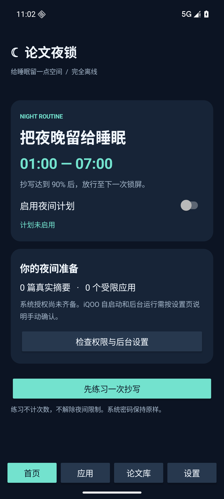
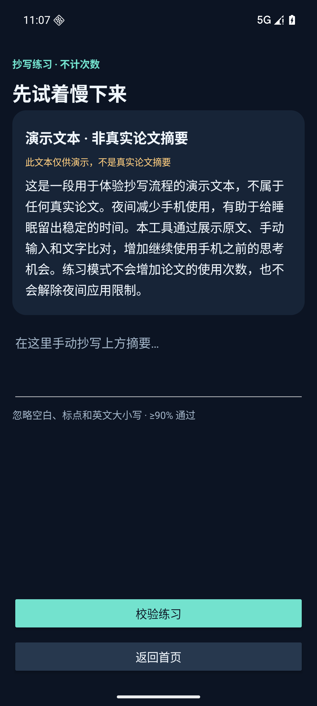

# 论文夜锁

供个人使用的离线 Android 自律工具。默认每天 **01:00—07:00** 限制你勾选的应用。看原文手动抄写论文摘要，文字准确率达到 **90%** 后，放行至下一次锁屏。

适配目标：iQOO 13 / Android 16；最低 Android 10。保留原有系统锁屏密码，不需要 root。实际真机验证范围见 `VALIDATION.md`。

## 下载与摘要库

从 [Releases](https://github.com/mojf3/paper-night-lock/releases) 下载 `paper-night-lock-v1.0.0.apk` 安装包。源码可从仓库的 Code → Download ZIP 下载。

已整理的 [十篇真实论文摘要库](library/papers-10-2026-10-20.json) 可直接在 App 的“论文库 → 导入 JSON 论文库”中导入。安装后也可手动添加、编辑摘要，或再次导入新库，**无需修改源码、重新打包或重新安装**。导入整库会替换旧库并清零使用次数。

推荐版将公式转换为便于手机键盘输入的文字；[arXiv 原始版](library/papers-10-2026-10-20-original.json) 供对照。版本、来源及第 9 篇摘要差异见 [摘要库说明](library/README.md)。安装权限步骤另见 [使用说明](docs/使用说明.md)。

| 首页 | 练习抄写 |
| --- | --- |
|  |  |

## 安装与首次设置

1. 将交付的 APK 传到手机，用文件管理器打开，并按系统提示允许此次安装。
2. 打开“论文夜锁”，在“论文库”添加至少一篇经核对的真实论文摘要，或导入 JSON 论文库。
3. 在“应用”勾选要限制的短视频、社交、浏览器等应用。电话、桌面、系统设置、输入法与本工具不能被勾选。
4. 在“设置”中开启“论文夜锁 · 应用限制”无障碍服务，并允许“闹钟和提醒”。无障碍服务只使用应用切换事件的包名，不读取其他应用的页面文字。
5. 如果安装包被系统限制开启无障碍：进入本工具的系统“应用信息”，检查右上角菜单中的“允许受限制的设置”，再返回开启服务。菜单名称以实际系统为准。
6. iQOO / OriginOS 中，在设置搜索“自启动”，允许本工具启动；搜索“后台耗电管理”或打开应用电池设置，允许后台运行。如有后台弹出界面开关，也允许本工具；最近任务中可将工具锁定。厂商开关无法由应用自动验证。
7. 回到首页，确认状态后开启“夜间计划”。若当时已处于夜间时段，会立即执行本轮首次锁屏。

状态通知可以另外授权，不影响核心使用。先点“先练习一次抄写”体验流程；演示文本不能代替真实论文库。

## 夜间行为

- 开始时执行一次系统锁屏。你仍通过原有密码或系统支持的验证方式解锁。
- 打开勾选应用时显示摘要验证界面；未勾选应用保持正常可用。
- 达到 90% 后，所有勾选应用一起放行。下次锁屏、重启或无障碍服务重新连接后，需重新抄写。
- 失败重试保持同一篇摘要；每轮优先选成功使用次数最少的摘要，同次数随机。
- 任意一篇成功使用满 3 次，在放行时提醒，首页和论文库也会持续标记。提醒不阻止继续使用。
- 07:00 自动解除应用限制，可自行修改开始、结束时间，也支持跨午夜时段。
- “返回桌面”可退出抄写界面；再次打开受限应用仍需验证。系统设置始终可用，关闭计划、关闭无障碍授权或卸载即可停止。

这是日常自律工具，不提供无法绕过的设备管控。强制停止应用、系统清理或撤销权限可能使计划中断；恢复后应打开本工具检查状态。首次使用请在白天设置一个几分钟后的短时段进行真机检查，确认后再改回 01:00—07:00。

## 判分与输入

原文和输入先进行 Unicode NFKC 全角/半角归一化，忽略空白、Unicode 标点和英文字母大小写，保留数字及数学符号。按 Unicode 码点计算编辑距离：

`准确率 = 1 - 编辑距离 / 两段文字中较长的长度`

判定使用整数条件 `编辑距离 × 10 <= 较长长度`，避免显示四舍五入把不足 90% 的输入判为通过。空输入及仅有标点的输入不通过。

显示百分比向下保留一位小数，避免不足 90% 时却显示为“90.0%”。

输入框关闭粘贴菜单、输入连接的粘贴命令及文本拖入，保留正常中文输入法组词。输入法自带剪贴板、语音、自动输入等方式不在首版识别范围。练习不计使用次数，也不产生夜间放行。

## 论文库格式

使用 UTF-8 编码的 JSON 数组，支持可选 BOM。`title`、`abstract` 必须是非空文字，`sourceUrl` 可省略。题名最多 300 字符，摘要最多 20,000 字符，文件最多 2 MB，每次最多 500 篇。

```json
[
  {
    "title": "真实论文题名",
    "abstract": "经核对的完整原文摘要……",
    "sourceUrl": "https://论文来源页面"
  }
]
```

导入前会检查全部条目并显示预览；确认后替换整库并清零次数。格式错误或取消导入时保持原库不变。手动修改摘要正文会重置该篇次数，单独修改题名或来源不会重置。

`examples/papers-template.json` 是占位格式模板，需替换内容。`library/` 中提供按指定十篇题名整理的真实论文库及来源说明；应用本身不内置这些摘要，需在安装后导入。内置练习仅使用明确标注的演示文本。

## 数据与权限

- 论文、次数和设置存储在应用私有本地数据库及偏好中，不申请联网权限，不上传其他应用内容。
- 无障碍配置不允许读取窗口内容，也不允许执行手势；使用的事件类型仅为窗口切换。
- 精确定时权限用于夜间开始和结束，重启、修改时间或时区后重新安排。
- 导入使用系统文件选择器，无需申请全部文件访问权限。
- 应用未启用系统云备份；卸载或清除应用数据会删除本地论文与次数。

## 从源码构建

需要 Android Studio 的 Java 运行时（Java 17 及以上）、Android SDK Platform 36、Build Tools 36，以及能访问 Google Maven / Maven Central 的网络。工程固定使用 AGP 9.0.1 / Gradle 9.1.0，Kotlin 使用 AGP 内置支持。

Windows PowerShell 在工程目录运行：

```powershell
.\build.ps1
```

脚本优先使用本机 Android Studio 运行时及已缓存的 Gradle 9.1.0；也可自行配置 `JAVA_HOME` 和 `ANDROID_HOME`。其他平台通过 Gradle Wrapper 执行：

```sh
sh ./gradlew :app:testDebugUnitTest :app:lintDebug :app:assembleDebug
```

安装包输出：`app/build/outputs/apk/debug/app-debug.apk`。交付 APK 为签名的个人测试版本。未来覆盖安装需保持相同签名。

## 自动化验证

JVM 测试覆盖准确率边界、Unicode、中英文、增删改、长文本、时间边界、跨午夜、时区和夏令时。

设备测试采用独立 Instrumentation，不依赖额外测试框架。**只在新安装的模拟器运行**：测试会写入测试论文、修改本工具计划、启用本工具无障碍，并在结束时清理测试论文与计划。不要在已有个人数据的真机直接运行此套测试。

```powershell
.\build.ps1 -IncludeDeviceTests
adb install -r app/build/outputs/apk/debug/app-debug.apk
adb install -r app/build/outputs/apk/androidTest/debug/app-debug-androidTest.apk
adb shell am instrument -w com.paper.nightlock.test/com.paper.nightlock.SmokeInstrumentation
```

设备测试覆盖数据库计数去重、第三次提醒条件、编辑重置、无效导入、粘贴限制、练习隔离、真实覆盖层、错误/正确输入、锁屏撤销放行、时段结束、关闭计划和系统设置可用性。iQOO 的后台行为仍需真机检查。

完整验收脚本还包含真正重启模拟器、检查定时任务恢复，以及从应用进程外撤销精确定时权限后的检查。在已启动、全新安装的 Android 16 模拟器上运行：

```powershell
.\test-device.ps1 -Serial emulator-5556
```

请把序列号替换为测试模拟器的序列号。脚本拒绝物理手机序列号，且首次核心测试要求论文库为空。Android 会在精确定时权限被撤销时终止应用，因此该检查单独从应用进程外进行。成功结束时测试数据和计划会被清理；若中途失败，只能在确认是测试模拟器后使用 `-e phase cleanup` 运行同一 Instrumentation 清理。
